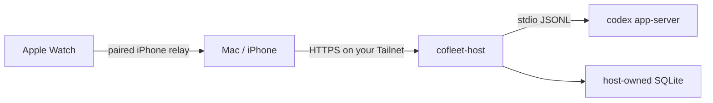

# CoFleet for Codex

CoFleet is an open-source Apple companion for Codex. It brings project and task
status, conversations, approvals, notes, todos, widgets, complications, and a
playful fleet view to Mac, iPhone, and Apple Watch without replacing Codex as
the source of truth for agent work.

> [!IMPORTANT]
> CoFleet is an independent project. It is not affiliated with, endorsed by, or
> sponsored by OpenAI. Codex and OpenAI are trademarks of their respective
> owners.

## What is included

- Native macOS, iOS, watchOS, WidgetKit, and Watch complication targets.
- Progress, Dashboard, Agent Bay, Active, and Battle destinations.
- Canonical Codex task history, streamed turns, approvals, questions, models,
  reasoning controls, and permission profiles.
- Direct pairing with one or more private hosts through Tailscale Serve.
- Host-owned rich notes, structured todos, and source-control status.
- Local import of user-owned Codex-compatible pets. CoFleet ships no pet art.

The host service runs one local `codex app-server` child and translates its
stdio JSONL protocol into a versioned, authenticated REST/SSE API. Raw Codex
credentials and the app-server transport are never exposed to Apple clients.
The public compatibility contract is checked in at
[`Docs/openapi.yaml`](Docs/openapi.yaml).



## Requirements

Build-time:

- macOS with Xcode 26 or newer and Swift 6.
- [XcodeGen](https://github.com/yonaskolb/XcodeGen).
- Python 3.9 or newer for the host service and tests.

Runtime:

- A supported, authenticated Codex installation on every project host.
- [Tailscale](https://tailscale.com/) for private multi-host access. Local-only
  development can use loopback without Tailscale.

Codex and Tailscale are runtime dependencies; neither is vendored or linked as
a compile-time dependency.

## Codex task ownership

Codex remains authoritative for task identifiers and transcripts on each
paired host. CoFleet can open a local task with its supported
`codex://threads/<id>` link. Remote-host tasks stay inside CoFleet because the
Codex desktop link does not carry a supported host identifier. The public app
does not ship keyboard automation or Accessibility-driven navigation.

## Bootstrap

```bash
brew bundle
cp Config/Local.xcconfig.example Config/Local.xcconfig
Scripts/bootstrap.sh
Scripts/doctor.sh
```

Edit `Config/Local.xcconfig` with identifiers you control before signing. The
example values are intentionally non-production placeholders.

## Build and test

Build commands never install or launch an application:

```bash
Scripts/build.sh macos
Scripts/build.sh ios-simulator
Scripts/build.sh ios-device
Scripts/build.sh watch
Scripts/test.sh
```

Installation is an explicit, separate action:

```bash
Scripts/install-macos.sh
Scripts/install-ios.sh --device <device-identifier>
```

The Xcode project is committed so a clean clone opens immediately. Regenerate
it after editing `project.yml` and verify that the committed project is current:

```bash
Scripts/generate-project.sh
Scripts/check-project-drift.sh
```

## Host service

The Python package lives in `Services/CoFleetHost`. To inspect the CLI directly
from a checkout:

```bash
PYTHONPATH=Services/CoFleetHost python3 -m cofleet_host --help
```

CoFleet hosts bind to loopback. Put HTTPS in front of the loopback service with
Tailscale Serve; never expose it with Funnel. Pairing creates a separate token
for every Apple device, and the host stores only token hashes.

CoFleet starts Codex's supported ChatGPT device-code sign-in from Dashboard
when the installed app-server advertises it. If that flow is unavailable in an
older Codex build, run `codex login` interactively on that host and refresh the
Dashboard; CoFleet never reads or copies the resulting credential files.

### Opt-in live smoke tests

Live Codex and Tailnet checks are deliberately excluded from the publication
gate and CI. The default local smoke creates temporary CoFleet state and reads
the authenticated Codex account, model catalog, recent-root suggestions, and a
five-item task page. It does not create a Codex task or consume model usage:

```bash
Scripts/smoke-live-codex.py --read-only
```

Codex still initializes its own local state runtime and may repair its task
metadata index during a read. The script never prints account data, project
paths, task titles, transcripts, pairing material, or app-server stderr.

The following modes consume subscription usage and leave one clearly named,
archived smoke task in canonical Codex history. They require the literal
acknowledgement flag:

```bash
Scripts/smoke-live-codex.py --safe-turn --confirm-live-usage
Scripts/smoke-live-codex.py --approval-probes --confirm-live-usage
```

The safe-turn mode verifies REST, SSE replay, transcript restoration, and
resume before archiving the task in a cleanup block. Approval probes
additionally exercise an isolated, no-side-effect Python command through deny
and allow decisions, then interrupt a synthetic sleep command. A missing
approval fails closed.

For a two-host Tailnet smoke, first run `cofleet-host pair` locally on each
already-deployed host. Then run:

```bash
Scripts/smoke-tailnet.py \
  --host-a https://host-a.example-tailnet.ts.net \
  --host-b https://host-b.example-tailnet.ts.net
```

Pairing codes are entered through hidden prompts, not arguments or environment
variables. The script accepts HTTPS `*.ts.net` Serve origins only, verifies
distinct private host identities and cross-host token rejection, and revokes
both temporary smoke devices in a cleanup block. It does not create folders,
projects, tasks, or turns. Successful script output is redacted counts and
fixed status labels only.

Neither script proves signed iPhone relay, Apple Watch notification/haptic
delivery, or physical complication behavior; those remain explicit device
tests after signing and installation are configured.

## Repository map

```text
Apps/                         Apple application and extension entry points
Packages/CoFleetKit/          Shared Swift models, transport, Codex, and UI
Services/CoFleetHost/         Python host service and Codex process adapter
Tests/                        Host and UI integration tests
Assets/                       Original app icon and asset catalogs
Config/                       Sanitized build configuration and plist inputs
Scripts/                      Build, test, install, and publication gates
.github/                      CI, security, and contribution automation
```

## Security and privacy

CoFleet is designed for a private Tailnet, not the public internet. Do not use
Tailscale Funnel for the host service. CoFleet never needs to read or copy
`~/.codex/auth.json`; Codex owns authentication.

See [SECURITY.md](SECURITY.md) for vulnerability reporting and
[PRIVACY.md](PRIVACY.md) for the data model.

## License

Copyright (C) 2026 Jean Diaz.

CoFleet is free software under `GPL-3.0-only` with the Section 7 Apple App Store
distribution permission reproduced in [LICENSE](LICENSE). The software comes
with absolutely no warranty.
